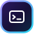
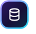

<p align="center">
  
</p>

<p align="center">
  <a href="https://www.npmjs.com/package/discord.js"></a>
  
  
  <a href="LICENSE"></a>
</p>

**NexoBot** (Anzeigename „Nexo“) ist ein modularer Discord-Community-Bot mit Moderation, Economy, Leveling, Tickets, Musik, Giveaways, Verifizierung und vielen Werkzeugen. Geschrieben in TypeScript mit discord.js v14, PostgreSQL als Datenspeicher.

> **Herkunft:** NexoBot basiert auf [TitanBot](https://github.com/codebymitch/TitanBot) von codebymitch (MIT-Lizenz) und wurde für diesen Bot überarbeitet: Rebranding, Umstellung auf TypeScript, zusammengefasste Commands und deutsche Texte.

## Inhalt

- [Funktionen](#funktionen)
- [Commands](#commands)
- [Einrichtung](#einrichtung)
  - [Lokal](#lokal)
  - [Docker](#docker)
  - [Railway](#railway)
- [Umgebungsvariablen](#umgebungsvariablen)
- [Intents und Berechtigungen](#intents-und-berechtigungen)

## Funktionen

- **Moderation** – Ban, Kick, Timeout, Verwarnungen, Fälle, Massenaktionen, Kanal-Sperren, Nutzernotizen
- **Economy** – Kontostand, Arbeit, Shop, Inventar, Glücksspiel, Überweisungen, Bestenliste
- **Leveling** – XP für Nachrichten, Rangkarten, Level-Rollen, Bestenliste
- **Tickets** – Panels, Claim, Priorität, Transkripte, Limits
- **Musik** – Lavalink v4 über Riffy, Warteschlange, Buttons, 24/7-Modus
- **Giveaways** – mehrere Gewinner, automatische Auslosung, Reroll
- **Willkommen** – Begrüßung, Abschied, Auto-Rollen
- **Verifizierung** – Button-Verifizierung und Auto-Verify
- **Weitere Module** – Geburtstage, Reaktionsrollen, Join-to-Create, Server-Statistiken, Logging, Bewerbungen, Zählspiel, Todo-Listen, Suche und viele Werkzeuge

Alle Funktionen lassen sich pro Server über `/configwizard` und `/commands` konfigurieren und einzeln sperren.

## Commands

NexoBot bündelt die Funktionen in thematische Commands mit Subcommands, zum Beispiel `/eco balance`, `/mod warn` oder `/music play`. Die vollständige Zuordnung der früheren Einzel-Commands steht in [docs/COMMAND_MIGRATION.md](docs/COMMAND_MIGRATION.md). `/help` zeigt alle Commands im Bot an.

## Einrichtung

Voraussetzungen: ein Bot im [Discord Developer Portal](https://discord.com/developers/applications) mit Token und Client-ID sowie den unten genannten Intents.

### Lokal

Benötigt Node.js 20.10 oder neuer und PostgreSQL.

```bash
git clone https://github.com/Robertwlt03/NexoBot.git
cd NexoBot
npm install
cp .env.example .env   # DISCORD_TOKEN, CLIENT_ID und Datenbank eintragen
npm run build
npm start
```

Für die Entwicklung startet `npm run dev` den Bot mit automatischem Neuladen direkt aus den TypeScript-Quellen. `npm run typecheck` prüft die Typen ohne Build. `npm test` führt die Tests aus.

Eine lokale Datenbank lässt sich am einfachsten per Docker starten:

```bash
docker compose up -d db
```

Die Compose-Datenbank läuft dann auf `127.0.0.1:5432` (User/Passwort/DB aus `POSTGRES_USER`, `POSTGRES_PASSWORD`, `POSTGRES_DB`). Sie hat kein SSL: Setze `POSTGRES_SSL=false`, sonst schlägt die Verbindung mit `NODE_ENV=production` fehl und der Bot läuft im In-Memory-Modus.

### Docker

```bash
cp .env.example .env   # mindestens DISCORD_TOKEN, CLIENT_ID, GUILD_ID setzen
docker compose up -d --build
```

Compose startet den Bot und PostgreSQL. Die Datenbank-Defaults (`nexobot` / `password` / `nexobot`) lassen sich über `POSTGRES_USER`, `POSTGRES_PASSWORD` und `POSTGRES_DB` in der `.env` überschreiben. Einen eigenen Lavalink-Knoten startet das Profil `local-lavalink`:

```bash
docker compose --profile local-lavalink up -d
```

Fertige Images: `ghcr.io/robertwlt03/nexobot`.

### Railway

1. Repository in Railway verbinden und einen PostgreSQL-Dienst hinzufügen.
2. Im Bot-Dienst `DISCORD_TOKEN`, `CLIENT_ID` und `GUILD_ID` setzen und `POSTGRES_URL` bzw. `DATABASE_URL` auf die private Railway-Datenbank-URL verweisen lassen.
3. Railway baut über das `Dockerfile`. Migrationen laufen beim Start automatisch (`AUTO_MIGRATE=true`).

Healthchecks: `GET /health` (Prozess lebt) und `GET /ready` (Bot verbunden und Datenbank bereit).

## Umgebungsvariablen

Alle Variablen mit Beispielwerten stehen in [.env.example](.env.example). Die wichtigsten:

| Variable | Pflicht | Beschreibung |
| --- | --- | --- |
| `DISCORD_TOKEN` | ja | Bot-Token aus dem Developer Portal |
| `CLIENT_ID` | ja | Application-ID; Slash-Commands werden global registriert |
| `GUILD_ID` | nein | Server-ID für die Einrichtung |
| `OWNER_IDS` | nein | Kommagetrennte Discord-IDs der Bot-Besitzer |
| `POSTGRES_URL` / `DATABASE_URL` | empfohlen | Verbindungs-URL zur Datenbank |
| `POSTGRES_HOST`, `POSTGRES_PORT`, `POSTGRES_DB`, `POSTGRES_USER`, `POSTGRES_PASSWORD` | alternativ | Einzelwerte statt URL |
| `POSTGRES_SSL` | nein | SSL erzwingen (`true`/`false`) |
| `AUTO_MIGRATE` | nein | Migrationen beim Start ausführen (Standard `true`) |
| `PORT`, `WEB_HOST` | nein | Port und Host für `/health` und `/ready` (Standard `3000`, `0.0.0.0`) |
| `LOG_LEVEL`, `LOG_TO_FILE` | nein | Log-Level und Datei-Logging |
| `LAVALINK_NODES_FILE`, `LAVALINK_NODES` | nein | Lavalink-Knoten für Musik |
| `TMDB_API_KEY` | nein | Für die Film- und Seriensuche |

Ohne erreichbare Datenbank läuft der Bot in einem eingeschränkten In-Memory-Modus. Für den Produktivbetrieb ist PostgreSQL Pflicht.

### Datenbank-Werkzeuge

```bash
npm run migrate          # Schema-Migrationen anwenden
npm run migrate:status   # Stand anzeigen
npm run backup:db        # Backup erstellen (pg_dump)
npm run restore:db       # Backup einspielen
```

Die Skripte laufen aus `dist/scripts/`, also vorher `npm run build` ausführen.

## Intents und Berechtigungen

Im Developer Portal aktivieren (Privileged Gateway Intents):

- **Server Members Intent**
- **Message Content Intent**

Der Bot nutzt außerdem die Intents Guilds, Guild Messages, Guild Message Reactions, Guild Voice States, Guild Moderation (Bans) und Direct Messages.

Einladung mit den Scopes `bot` und `applications.commands` und diesen Berechtigungen:

- Kanäle ansehen, Nachrichten senden, Links einbetten, Dateien anhängen, Nachrichtenverlauf lesen
- Nachrichten verwalten, Kanäle verwalten, Rollen verwalten
- Mitglieder kicken, Mitglieder bannen, Mitglieder moderieren (Timeout)
- Verbinden und Sprechen (Musik)

<p align="center">
  
  <br>
  <sub><a href="LICENSE">Lizenz</a> · <a href="https://github.com/codebymitch/TitanBot">TitanBot</a> · <a href="docs/COMMAND_MIGRATION.md">Command-Migration</a></sub>
</p>
