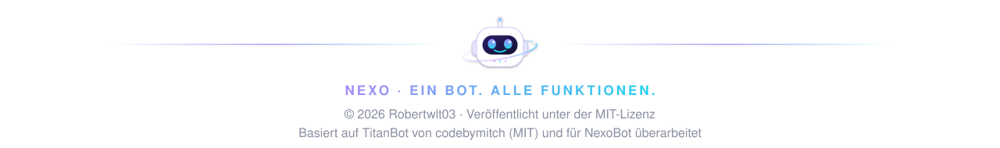

  

NexoBot fasst die früheren Einzel-Commands thematisch zusammen. Aus 99 Top-Level-Commands werden 36. Command-Namen innerhalb der Gruppen, Optionen und Buttons bleiben gleich.

## Was gleich bleibt

- **Gesperrte Commands:** Sperren aus `/commands` mit alten Namen gelten weiter. Ein gesperrtes `/balance` sperrt `/eco balance`, ein gesperrtes `/usernotes` sperrt `/msg notes`. Gesperrte Kategorien gelten auch für Commands, die in eine andere Kategorie gewandert sind (z. B. `/weather` aus Utility).
- **Prefix-Commands:** Alte Namen und Aliase funktionieren weiter: `!bal` → `/eco balance`, `!unban` → `/ban remove`, `!usernotes view @User` → `/msg notes view @User`.
- **Cooldowns:** Cooldowns und Missbrauchsschutz zählen weiter pro altem Command.
- **`/commands disable balance`** akzeptiert alte Namen und sperrt den neuen Subcommand.

Bei Namen, die es alt und neu gibt (`/ban`, `/kick`, `/rank`, `/welcome`), behält ein alter Eintrag seine alte Bedeutung: Ein gesperrtes `/ban` sperrt nur `/ban user`, ein gesperrtes `/welcome` nur `/welcome message`. Wer heute den ganzen neuen Command sperrt, sperrt alle Subcommands.

## Unverändert

`/help`, `/commands`, `/configwizard`, `/todo`, `/report`, `/wipedata`, `/apply`, `/app-admin`, `/count`, `/ticket`, `/cases`, `/verify`, `/birthday`, `/jointocreate`, `/logging`, `/reactroles`, `/search`, `/serverstats`

Bestehende Subcommands bleiben außerdem direkt erhalten bei `/economy` (dashboard), `/music` (pause, resume, skip, …), `/level` (setup, dashboard) und `/verification` (setup, remove, dashboard).

## Zuordnung

`…` bedeutet: Die alten Subcommands bleiben unter der neuen Gruppe erhalten, z. B. `/usernotes add` → `/msg notes add`.

| Alt | Neu | Alte Kategorie |
| --- | --- | --- |
| `/ban` | `/ban user` | Moderation |
| `/unban` | `/ban remove` | Moderation |
| `/massban` | `/ban mass` | Moderation |
| `/ping` | `/bot ping` | Core |
| `/stats` | `/bot stats` | Core |
| `/support` | `/bot support` | Core |
| `/uptime` | `/bot uptime` | Core |
| `/lock` | `/channel lock` | Moderation |
| `/unlock` | `/channel unlock` | Moderation |
| `/balance` | `/eco balance` | Economy |
| `/beg` | `/eco beg` | Economy |
| `/buy` | `/eco buy` | Economy |
| `/crime` | `/eco crime` | Economy |
| `/daily` | `/eco daily` | Economy |
| `/deposit` | `/eco deposit` | Economy |
| `/eleaderboard` | `/eco leaderboard` | Economy |
| `/fish` | `/eco fish` | Economy |
| `/gamble` | `/eco gamble` | Economy |
| `/inventory` | `/eco inventory` | Economy |
| `/mine` | `/eco mine` | Economy |
| `/pay` | `/eco pay` | Economy |
| `/rob` | `/eco rob` | Economy |
| `/shop` | `/eco shop` | Economy |
| `/slut` | `/eco slut` | Economy |
| `/withdraw` | `/eco withdraw` | Economy |
| `/work` | `/eco work` | Economy |
| `/shop-config …` | `/economy shop …` | Economy |
| `/fight` | `/fun fight` | Fun |
| `/flip` | `/fun flip` | Fun |
| `/roll` | `/fun roll` | Fun |
| `/gcreate` | `/giveaway create` | Giveaway |
| `/gdelete` | `/giveaway delete` | Giveaway |
| `/gend` | `/giveaway end` | Giveaway |
| `/greroll` | `/giveaway reroll` | Giveaway |
| `/avatar` | `/info avatar` | Utility |
| `/serverinfo` | `/info server` | Utility |
| `/userinfo` | `/info user` | Utility |
| `/kick` | `/kick user` | Moderation |
| `/masskick` | `/kick mass` | Moderation |
| `/leveladd` | `/level add` | Leveling |
| `/levelremove` | `/level remove` | Leveling |
| `/levelset` | `/level set` | Leveling |
| `/timeout` | `/mod timeout` | Moderation |
| `/untimeout` | `/mod untimeout` | Moderation |
| `/warn` | `/mod warn` | Moderation |
| `/warnings` | `/mod warnings` | Moderation |
| `/dm` | `/mod dm` | Moderation |
| `/purge` | `/msg purge` | Moderation |
| `/say` | `/msg say` | Moderation |
| `/embedbuilder` | `/msg embed` | Tools |
| `/usernotes …` | `/msg notes …` | Moderation |
| `/join` | `/music join` | Music |
| `/play` | `/music play` | Music |
| `/queue` | `/music queue` | Music |
| `/nowplaying` | `/music nowplaying` | Music |
| `/rank` | `/rank view` | Leveling |
| `/leaderboard` | `/rank leaderboard` | Leveling |
| `/claim` | `/tickets claim` | Ticket |
| `/close` | `/tickets close` | Ticket |
| `/priority` | `/tickets priority` | Ticket |
| `/baseconvert` | `/tools baseconvert` | Tools |
| `/calculate` | `/tools calculate` | Tools |
| `/countdown` | `/tools countdown` | Tools |
| `/generatepassword` | `/tools generatepassword` | Tools |
| `/hexcolor` | `/tools hexcolor` | Tools |
| `/poll` | `/tools poll` | Tools |
| `/randomuser` | `/tools randomuser` | Tools |
| `/shorten` | `/tools shorten` | Tools |
| `/time` | `/tools time` | Tools |
| `/unixtime` | `/tools unixtime` | Tools |
| `/weather` | `/tools weather` | Utility |
| `/firstmsg` | `/tools firstmsg` | Utility |
| `/autoverify …` | `/verification autoverify …` | Verification |
| `/autorole …` | `/welcome autorole …` | Welcome |
| `/goodbye …` | `/welcome goodbye …` | Welcome |
| `/greet …` | `/welcome greet …` | Welcome |
| `/welcome …` | `/welcome message …` | Welcome |

  

